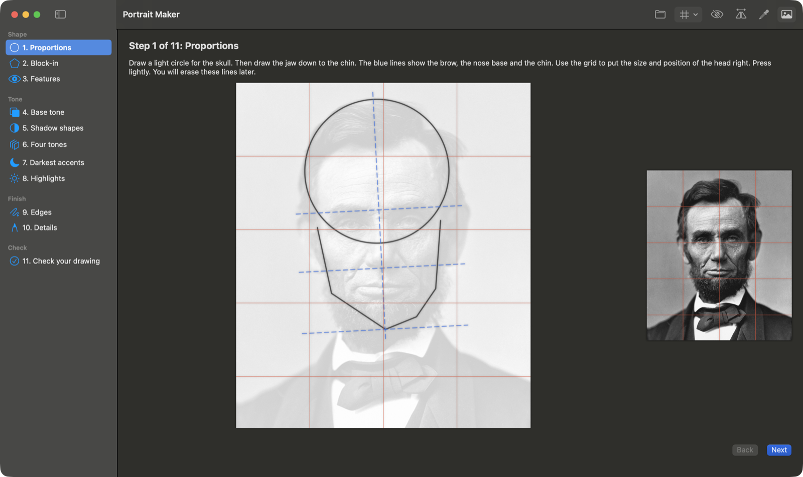
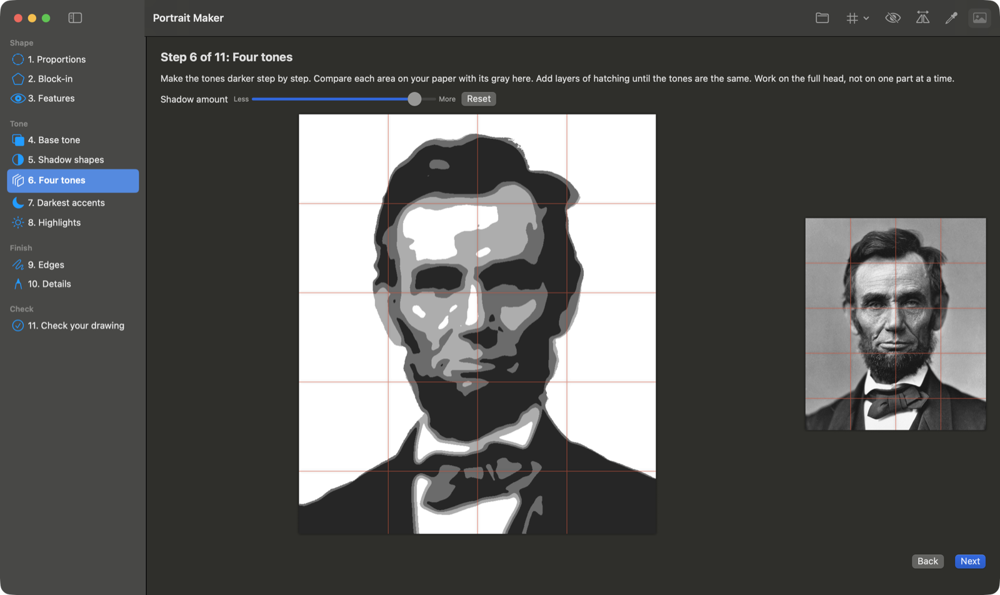
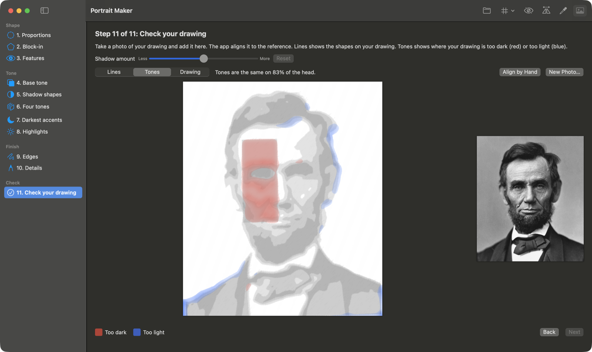

# Portrait Maker

A Mac app that teaches you to draw a portrait from a photo, step by step. Open a portrait, and the app makes a series of guide screens: first the proportions and the big shapes, then the tones from light to dark, then edges and details. At the end, you take a photo of your drawing and the app shows where your shapes and tones are different from the reference.

The method follows a short tutorial by [Will Davies (@willdaviesart)](https://www.instagram.com/willdaviesart/): change the photo into a few flat tone shapes, then copy those shapes in order, instead of shading small parts one at a time.

<p align="center">
  
</p>
<p align="center">
  
  
</p>

## Features

- **11 steps in 4 groups.** You can skip any step from the sidebar.
  - Shape: proportions (skull circle, jaw, brow, nose and chin lines), block-in with straight lines, features on guide lines.
  - Tone: base tone, shadow shapes, four tones, darkest accents, highlights.
  - Finish: hard and soft edges, details.
  - Check: compare a photo of your drawing with the reference.
- **Grid** with 3, 4, 6 or 8 columns of square cells on all pictures.
- **Shadow amount** slider that moves the split between the tones.
- **Compare tones**: click two points, and the app shows each tone on the same neutral gray. Your eye then cannot be tricked by the tones around them.
- **Squint** (blur) and **Flip** (mirror) to check proportions and big tones.
- **Check your drawing**: the app aligns a photo of your paper to the reference, by the eyes (found automatically, or by two clicks), and then corrects the alignment with the tones of the full head. It corrects uneven light on the paper. It has three views: the reference lines on your drawing, a map of the areas that are too dark or too light, and the aligned drawing.

All image processing happens on your Mac. The app makes no network calls.

## Requirements

- macOS 14 or later
- To build: Xcode 15.3 or later (the SwiftUI macros need the Xcode toolchain, not only the Command Line Tools)

## Install

Download `PortraitMaker.zip` from [Releases](../../releases), unzip it, and move `PortraitMaker.app` to Applications. The app is not signed or notarized, so the first time, right-click the app and choose **Open**.

Or build from source:

```sh
git clone https://github.com/tilakp/portrait-maker.git
cd portrait-maker
./build_app.sh            # builds PortraitMaker.app
./build_app.sh --install  # also copies it to /Applications
```

## Usage

1. Open a portrait: click **Open**, or drop a photo on the window. A clear photo with strong light from one side gives the best tone maps.
2. Go through the steps with **Next** (Return) and **Back**, or click a step in the sidebar.
3. On **Check your drawing**, add a photo of your paper. Take it from straight above, in even light. If the app does not find the face in your drawing, click the center of the eye on the left, then the eye on the right.

From the terminal, you can open a portrait and a drawing at launch:

```sh
open -a PortraitMaker.app --args <portrait> [<photo of drawing>]
```

A debug mode writes every step as a PNG file:

```sh
PortraitMaker.app/Contents/MacOS/PortraitMaker --render <portrait> <output folder> [<photo of drawing>]
```

## How it works

- **Face and person**: Apple's Vision framework finds the face, the face landmarks (jaw, brows, eyes, nose, lips) and a mask of the person. The app crops the photo to the head.
- **Lines**: the head outline comes from the person mask. The Douglas-Peucker algorithm keeps only its corners, so curves become straight lines. The guide lines are parallel to the line between the eyes.
- **Tones**: the photo is changed to grayscale and blurred. The tone splits are percentiles of the tones inside the face, so dark hair and clothes do not move them. The shadow amount slider moves the percentiles.
- **Edges**: a Sobel filter on the blurred photo. The strongest changes of tone are hard edges.
- **Drawing check**: a similarity transform puts the drawing's eyes on the reference's eyes. A coarse-to-fine search over size, rotation and position then finds the best Pearson correlation between the drawing and the photo. The light on the paper is a smooth surface fitted to the paper around the head. The difference with the four-tone map is smoothed, so a small alignment error at a tone edge does not show as a wrong area.

## Project layout

```
Sources/PortraitMaker/
  Stage.swift             the steps, their order and their instructions
  LessonBuilder.swift     Vision, tone maps, edges and line drawings
  DrawingCheck.swift      alignment and comparison of a photo of a drawing
  PortraitMakerApp.swift  the SwiftUI app and the --render debug mode
Resources/Info.plist
build_app.sh              builds and signs the .app bundle
```

## Attribution

- The drawing method is from a tutorial reel by Will Davies ([@willdaviesart](https://www.instagram.com/willdaviesart/)).
- The screenshots use the 1863 portrait of Abraham Lincoln by Alexander Gardner, which is in the public domain ([Wikimedia Commons](https://commons.wikimedia.org/wiki/File:Abraham_Lincoln_O-77_matte_collodion_print.jpg)). The drawing in the check screenshot is a test image made from the app's own four-tone map, with one area made darker on purpose.

## License

[MIT](LICENSE)
