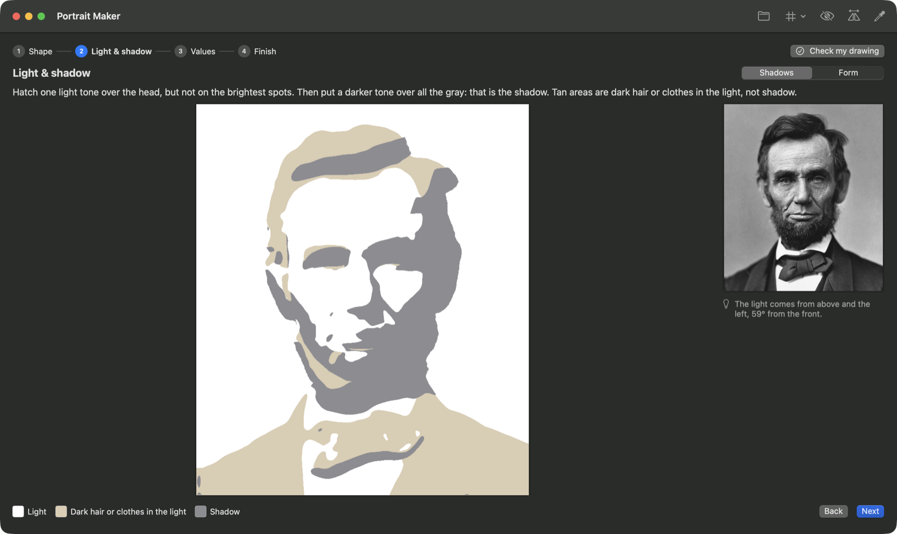
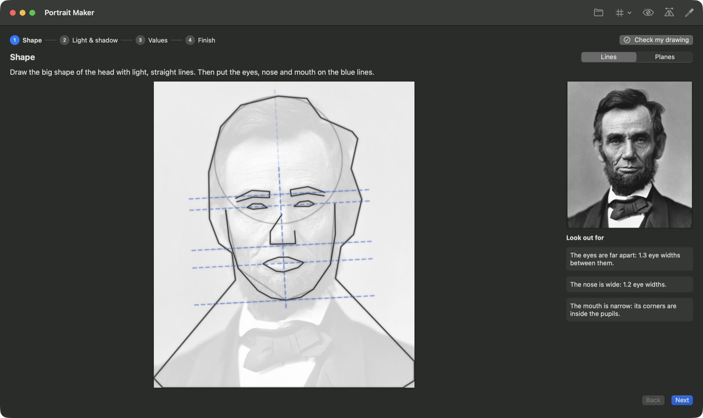
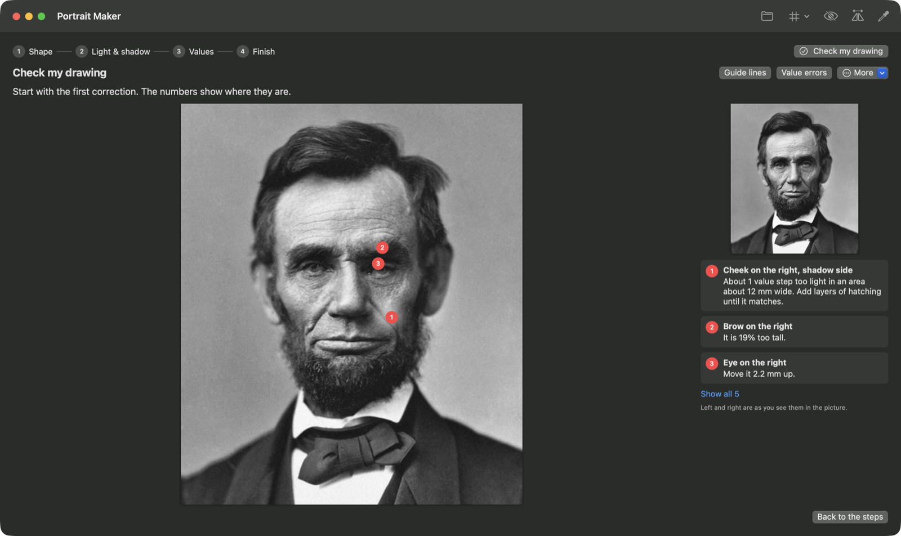

# Portrait Maker

A Mac app that teaches you to draw a portrait from a photo, one step at a time, the way a drawing teacher would. Open a portrait and follow four steps: **Shape**, **Light & shadow**, **Values** and **Finish**. Each step shows one guide picture and tells you in a sentence or two what to draw. When you are done, take a photo of your drawing: the app tells you the few things to correct first, and shows on your drawing where they are.

The method follows a tutorial by [Will Davies (@willdaviesart)](https://www.instagram.com/willdaviesart/): change the photo into a few flat value shapes, then copy those shapes in order, instead of shading small parts one at a time.

<p align="center">
  
</p>
<p align="center">
  
  
</p>

## The four steps

| Step | Main view | More detail |
|---|---|---|
| 1. Shape | The big shape in straight lines, with guide lines for the eyes, nose and mouth. Notes such as "The eyes are far apart" show what is special about this face. | The planes of the head |
| 2. Light & shadow | The shadow shapes. Dark hair or clothes in the light are shown apart from the shadow. | The form: halftone, core shadow, reflected light, cast shadows |
| 3. Values | The photo in a few flat grays. Choose from 2 to 9 values. | The darkest darks and the highlights |
| 4. Finish | Hard and soft edges | The photo, for the details |

**Check my drawing.** Photograph all of your paper and choose the paper size. The app finds the paper, lines your drawing up with the photo, and lists the corrections, the most important first: for example "Eye on the right: Move it 2.2 mm up", or "Cheek on the right, shadow side: About 1 value step too light". Numbers on your drawing show where each correction is. Turn on **Guide lines** or **Value errors** to see more.

**Tools in the toolbar:** a grid, Squint (blur), Flip (mirror) and Compare values (two points on the same neutral gray, so the values around them cannot trick your eye).

Behind the simple screens, a depth model gives the 3D form of the head. This is how the app finds the direction of the light, tells shadow from dark hair, and shades the planes. All image processing happens on your Mac. The app makes no network calls, and the depth model is in the app bundle.

## Accuracy

I tested the drawing check with test drawings made from two reference photos (Lincoln, 1863, and Marie Curie, about 1920). The test drawings have pencil texture and are on A4 paper with uneven light, photographed in perspective on a dark table.

| Test drawing | What the app reports |
|---|---|
| Exact copy (both photos) | No corrections. Values match on 99% and 100% of the head. |
| Eye moved 2.7 mm down | "Move it 2.2 mm up" (Lincoln), "Move it 1.8 mm up" (Curie) |
| Mouth 18% wider | "15% too wide" (Lincoln), "19% too wide" (Curie) |
| Cheek much lighter | "About 1 value step too light" (both) |
| Scale of the paper | 0.1686 to 0.1693 mm per pixel, true value 0.1694 |

The test drawings are copies of the photo with changes made on purpose, so these results show the accuracy of the measurement, not of every drawing style. The check has not been tested on many real pencil drawings yet. Unit tests (`swift test`) cover the light fit, the local shape search, the alignment of the drawing as a whole, the tone matching and the wording of the corrections.

## Requirements

- macOS 14 or later. Tested on Apple silicon.
- To build: Xcode 15.3 or later (the SwiftUI macros need the Xcode toolchain, not only the Command Line Tools), and a network connection the first time, to download the depth model (50 MB).

## Install

Download `PortraitMaker.zip` from [Releases](../../releases), unzip it, and move `PortraitMaker.app` to Applications. The app is not signed or notarized, so the first time, right-click the app and choose **Open**.

Or build from source:

```sh
git clone https://github.com/tilakp/portrait-maker.git
cd portrait-maker
./build_app.sh            # downloads the depth model once, builds PortraitMaker.app
./build_app.sh --install  # also copies it to /Applications
swift test                # unit tests
```

The first time the app starts after an install, Core ML prepares the depth model on the GPU in the background, which takes about 10 seconds. After that, a portrait takes about 1 second.

## Usage

1. Open a portrait: click **Open**, or drop a photo on the window. A clear photo with strong light from one side gives the best results.
2. Go through the steps with **Next** (Return) and **Back**, or click a step at the top. The switch at the top right of each step shows more detail.
3. On **Check my drawing**, add a photo of all of your paper from straight above, in even light, on a darker table, and choose the paper size. If the app does not find the face in your drawing, click the center of the eye on the left, then the eye on the right.

From the terminal:

```sh
# Open a portrait and a drawing at launch
open -a PortraitMaker.app --args <portrait> [<photo of drawing>]

# Write every step as a PNG file, and print the measurements and the corrections
PortraitMaker.app/Contents/MacOS/PortraitMaker --render <portrait> <output folder> [<photo of drawing> [A4|A3|Letter|...]]

# Write the depth, normals, fitted light and form classes as PNG files
PortraitMaker.app/Contents/MacOS/PortraitMaker --form <portrait> <output folder>
```

Set `PM_DEBUG=1` to print the timing of each step and the result of each local search.

## How it works

- **Face and person**: Apple's Vision framework finds the face, the face landmarks and a mask of the person, and the app crops the photo to the head.
- **Form**: Depth Anything V2 Small (Core ML, on the GPU) gives relative depth. The depth is scaled so that the nose tip is in front of the cheek outline by half the face width, and the surface normals come from it.
- **Light**: a Lambertian fit on the skin, brightness = ambient + albedo × (normal · light). Pixels that are much darker than the fit (a beard, a cast shadow) are removed, and the fit runs again.
- **Families and form**: on smooth skin, a dark tone means shadow. On hair, a beard, the brows and clothes, the 3D form decides if a dark area is a shadow or a dark local value. Hair and beards are found by their fine texture. The terminator is moved to where the form agrees best with the photo.
- **Planes**: k-means clustering of the smoothed normals into 12 directions, started from fixed directions so that the result is the same each time.
- **Lines**: the head outline comes from the person mask. The Douglas-Peucker algorithm keeps only its corners, so curves become straight lines.
- **Drawing check**: Vision finds the paper, and Core Image removes the perspective. The light on the paper is fitted to a band along the edges of the paper. The alignment uses the eyes, then a coarse-to-fine search over size, rotation and position (Pearson correlation). For each area, the app matches the tone distribution of the drawing to the photo and searches the position and the size again. One similarity transform is fitted to all the local results without the outliers, and only what is left is reported. Widths come from the corners of the mouth and the wings of the nose.

## Project layout

```
Sources/PortraitMaker/
  Stage.swift            the four steps, their views and instructions
  LessonBuilder.swift    Vision, value maps, edges, lines, and the lesson model
  FormAnalysis.swift     depth model, normals and the light fit
  FormClasses.swift      light and shadow families, form classes and planes
  Measurements.swift     proportions in eye widths and head units
  DrawingCheck.swift     paper detection, perspective, white balance and alignment
  DrawingFeedback.swift  shape and value corrections
  LinearAlgebra.swift    least squares
  ContentView.swift      the SwiftUI app
  Entry.swift            app entry and the --render and --form debug modes
Tests/PortraitMakerTests/ unit tests
scripts/fetch_model.sh   downloads and checks the depth model at a fixed commit
scripts/make_icon.swift  draws the app icon
build_app.sh             builds and signs the .app bundle
```

## Attribution

- The drawing method is from a tutorial reel by Will Davies ([@willdaviesart](https://www.instagram.com/willdaviesart/)).
- Depth model: [Depth Anything V2](https://github.com/DepthAnything/Depth-Anything-V2) by Lihe Yang et al., Small model, Apache License 2.0, in [Apple's Core ML conversion](https://huggingface.co/apple/coreml-depth-anything-v2-small). See [THIRD_PARTY_NOTICES.md](THIRD_PARTY_NOTICES.md).
- The screenshots use the 1863 portrait of Abraham Lincoln by Alexander Gardner, which is in the public domain ([Wikimedia Commons](https://commons.wikimedia.org/wiki/File:Abraham_Lincoln_O-77_matte_collodion_print.jpg)). The drawing in the check screenshot is a test image made from the photo, with errors added on purpose.

## License

[MIT](LICENSE)
